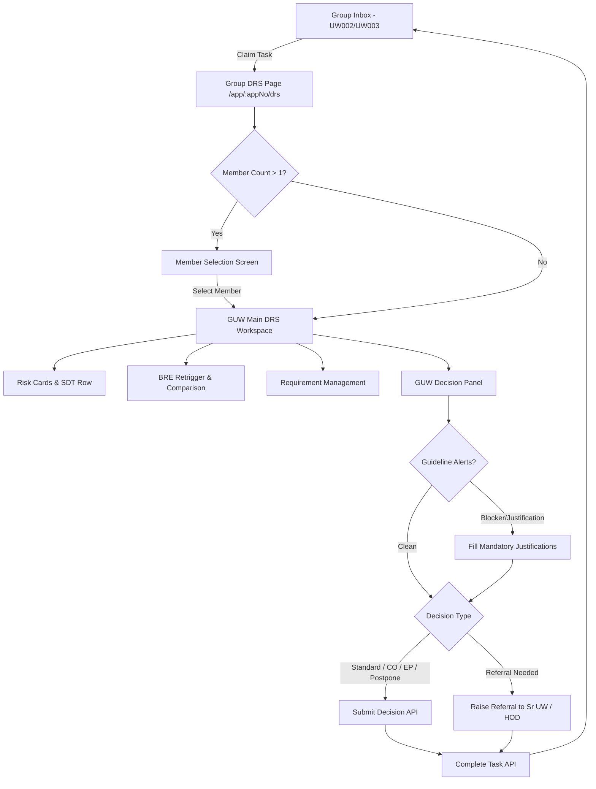

# Release Note & SIT Specification — Group Underwriter (GUW) DRS Module

**Application:** Mid-Office — Group Underwriting (Formal & Informal)  
**Role:** Group Underwriter (`GUW`, `GUW_TASK`, `GROUP_GUW_FORMAL_USER`, `GROUP_GUW_INFORMAL_USER`)  
**Routes:** `/app/:applicationNo/drs`, `/app/:applicationNo/drs/medical`, `/app/:applicationNo/drs/financial`, `/guw/member-selection`, `/inbox`  
**Document Version:** 1.0.0  
**Status:** Approved for SIT & Release Review  

---

## 1. Executive Summary & Purpose

The **Group Underwriting (GUW) Decision Recording System (DRS)** is the primary operational workspace for Group Underwriters. It empowers underwriters to evaluate multi-life group schemes and individual member proposals, review automated Business Rules Engine (BRE) recommendations, analyze medical/financial assessments, manage pending underwriting requirements, resolve guideline validations/justifications, configure counter-offers or extra premiums, and record final decisions or raise multi-tier referrals (to Sr. UW, HOD, Claim Audit, or Reinsurers).

---

## 2. Key Capabilities & Feature Breakdown

### 2.1 Group DRS Outer Shell & Header
- **Applicant & Scheme Banner (`ApplicantBanner` / `SchemeBanner`):** Displays Scheme/Application No, Member Photo/Avatar, Life Assured Name, Product Line, Riders, and Sum at Risk.
- **Risk Cards Overview (`RiskCards`):** Instant summary across four core dimensions:
  1. *Application Detail:* Scheme type, proposal date, channel, sourcing entity.
  2. *Source Detail:* Branch, agent/broker code, intermediary credentials.
  3. *Group Detail:* Master policyholder, group category, total member count, eligibility criteria.
  4. *Risk Detail:* Sum assured, underwriting risk tier, occupational category, smoker flag.
- **Deep-Dive Navigation:** Dedicated "View Medical" and "View Financial" sub-pages with seamless multi-member switching and return navigation.

### 2.2 Quick Links Ecosystem (`QuickLinksModule`)
- **Applicant Profile:** Interactive dialog presenting detailed member demographic, occupational, and KYC data.
- **Proposal Form & Documents:** Document viewer for signed proposal forms, identity proofs, and address validations.
- **Previous Policies:** Direct access to historical coverage, prior claims, and active policy records across lines of business.
- **Open Tasks:** Overview of parallel workflow tasks currently assigned or in flight for the scheme/member.
- **Risk Details:** Comprehensive breakdown of risk scores, exclusions, and rating factors.
- **Audit Trail:** Time-stamped history of field edits, state changes, and user interactions.
- **Raise Grievance:** Dedicated modal for logging operational issues, document discrepancies, or servicing grievances.

### 2.3 Automated Decisioning & BRE Integration (`BreCard`)
- **Initial vs. Final Decision Tracking:** Visual side-by-side indicator of initial rule outcomes vs. current evaluated state.
- **Decision Comparison Dialog:** Granular comparison modal highlighting discrepancies, modified risk parameters, and rule variances.
- **BRE Retrigger Engine:**
  - One-click rule re-evaluation triggering updated underwriting scores.
  - Multi-attempt safety limit: If retrigger count exceeds 3 attempts in session, the API call is prevented, and a prompt instructs the underwriter to raise an IT ticket.

### 2.4 Requirement Management (`RequirementManagementTable`)
- View active, raised, and received underwriting requirements categorized by status.
- Add new requirements with custom follow-up codes and mandatory submission deadlines.
- Edit/Remove existing requirements before final case submission.
- Real-time persistence via the `saveGroupDrsRequirements` API.

### 2.5 Strategic Data Tracking (SDT) & Claim Audit
- **SDT Row (`GuwSdtRow`):** Strategic underwriter flags including high-risk indicators, fraud alerts, and special processing tags.
- **Claim Audit Integration:** Lazy-loaded modal fetching past claim audit history (`/api/v1/drs/claim-audit/list`) for deeper risk evaluation.

### 2.6 Comprehensive Decisioning & Validation Engine (`GuwUwPanel`)
- **Decision Typology:**
  - *Standard (STD) & Borderline Standard (BOR_STD):* Clean approvals without alterations.
  - *Counter Offer (CO):* Adjust Sum Assured (SA), Policy Term (PT), or deny specific riders with reason codes.
  - *Extra Premium (EP):* Apply loading classes (e.g., `GUW_EP_LOAD_CLS`) and loading reasons (`GUW_EP_LOAD_RSN_CODE`).
  - *Postpone (POSTP):* Defer acceptance with structured postponement period (`POSTPONE_PERIOD`).
  - *Decline Cover (DC) & Rejection (REJ):* Decline risk with mandatory rejection justification.
  - *Hold:* Temporary case hold with reason code selection (`GUW_HOLD_RSN`).
- **Guideline & Validation Engine:**
  - Evaluates system guidelines across Medical, Financial, and Risk dimensions.
  - Enforces mandatory reason and remark justifications before allowing terminal decision submission.
  - Identifies blocker alerts that prevent terminal decisions by junior underwriters.
- **Referral & Reinsurance Matrix:**
  - Parallel and sequential referrals to **Sr. UW (`REF_SR_UW`)**, **HOD (`REF_HOD`)**, **Claim Audit (`REF_CUW_CLM`)**, and **ACU (`REF_ACU`)**.
  - Reinsurance allocation support across accredited reinsurers (Swiss Re, Munich Re, Scor Re, Gen Re, RGA Re, Hannover Re).

---

## 3. Architecture & Data Flow

---

## 4. API Integration & Environment Matrix

| API Operation | Endpoint | Method | Trigger Component | Status | Impact / Behavior |
|---|---|---|---|---|---|
| **Claim Task** | `/api/v1/inbox/claim` | POST | `GroupInboxPage` | Active / Working | Case locks to current underwriter |
| **Fetch DRS** | `/api/v1/drs/fetch` | POST | `GuwUser` (`useGetGroupDrsQuery`) | Active / Working | Populates scheme, banner, risk cards & member data |
| **BRE Retrigger** | `/api/v1/bre/retrigger` | POST | `GuwUser` (`useRetriggerGroupBreMutation`) | Monitored | Re-calculates underwriting rules and updates decision bar |
| **Save Requirements** | `/api/v1/drs/requirements/save` | POST | `GuwUser` (`useSaveGroupDrsRequirementsMutation`) | Active / Working | Persists added/edited requirement items |
| **Claim Audit List** | `/api/v1/drs/claim-audit/list` | POST | `GuwUser` (`useLazyGetGuwClaimAuditListQuery`) | Active / Working | Loads prior claims investigation history in modal |
| **Financial Details** | `/api/v1/drs/financial` | POST | `GuwUser` (`useGetGroupFinancialDetailsQuery`) | Active / Working | Loads detailed income, balance sheet & ratio metrics |
| **UW Decision** | `/api/v1/drs/uw-decision` | POST | `GuwUwPanel` | Active / Working | Submits member-level decision & counter-offer payload |
| **Complete Task** | `/api/v1/task/complete` | POST | `GuwUwPanel` | Active / Working | Completes workflow step and routes case to next stage |

---

## 5. System Integration Testing (SIT) Scenarios

| Test ID | Area | Scenario & Action | Test Steps | Expected Result | Priority |
|---|---|---|---|---|---|
| **GUW-01** | Navigation | Multi-life Scheme Detection | Open multi-member scheme from Inbox | Redirects to `/guw/member-selection` displaying all eligible lives | P1 |
| **GUW-02** | Banner | Scheme & Life Assured Info | Load claimed DRS case | Scheme Banner shows Product, Policy Term, Riders, Sum at Risk | P1 |
| **GUW-03** | BRE Retrigger | Normal Retrigger Path | Click "BRE Retrigger" (< 3 attempts) | Full-screen loader shows; Final decision, remarks, discrepancy update | P1 |
| **GUW-04** | BRE Retrigger | Exceed Retrigger Limit | Retrigger 4th time in same session | Blocked with "Kindly raise ticket with IT team" dialog; no API hit | P1 |
| **GUW-05** | Requirements | Add & Save Requirement | Click Add Req -> Enter Code -> Save | Requirements table updates; success snackbar displayed | P1 |
| **GUW-06** | Medical/Financial | Drill-down Sub-pages | Click View Medical / View Financial | Navigates to `/drs/medical` or `/drs/financial`; back button restores DRS | P1 |
| **GUW-07** | Guidelines | Blocker Alert Enforcement | Attempt terminal decision on blocker rule | Blocked with "User is not allowed to provide terminal decisions" | P1 |
| **GUW-08** | Guidelines | Justification Validation | Submit with empty justification remark | Prevented: "Please select a reason for all justifications and checklists" | P1 |
| **GUW-09** | Counter-Offer | SA / PT Alteration | Select Decision = CO -> Adjust SA/PT | Counter offer grid validates; values attached to final payload | P1 |
| **GUW-10** | Extra Premium | Loading Class & Reason | Select Decision = EP -> Add Loading | Master dropdowns populate; percentage/rate loading computed | P1 |
| **GUW-11** | Referral | Refer to Senior UW | Select "Refer to Sr. UW" -> Select Assignee | Assignee dropdown lists active Sr UWs; case routes to SR_UW pool | P1 |
| **GUW-12** | Referral | Refer to HOD | Select "Refer to HOD" -> Enter Remarks | Assignee lists active HODs; case routes to HOD pool | P1 |
| **GUW-13** | Task Completion | Successful Case Submission | Complete all validations -> Click Submit | Task completes, session cache clears, user navigates to Inbox | P1 |

---

## 6. Known Issues, Limitations & Mitigations

| Issue ID | Module | Description | Root Cause / Note | Workaround / Action Plan |
|---|---|---|---|---|
| **KI-GUW-01** | BRE Retrigger | CORS failure on certain gateway clusters | Preflight `OPTIONS` not enabled for UI origin on specific staging proxies | Infra team to whitelist gateway CORS headers |
| **KI-GUW-02** | Session Storage | Retrigger counter stored in session memory | Intended design for ephemeral limits | Clears on logout or tab close; backend audit logs record total count |
| **KI-GUW-03** | Multi-life Save | Storing partial draft for multi-member | Decisions saved per-member key (`guwMemberDecisionKey`) | Final task complete only triggers when all members have decisions |

---

## 7. Sign-Off & Verification Checklist

- [ ] Successful Inbox claim and member navigation.
- [ ] Risk cards and SDT indicators verified against mock/backend contracts.
- [ ] BRE retrigger and comparison modal functioning within limits.
- [ ] Requirement addition, modification, and deletion verified.
- [ ] Guideline blocker and justification validation rules strictly enforced.
- [ ] Referral routing to Sr. UW and HOD queues verified.
- [ ] Clean redirection to Inbox upon final submission.
