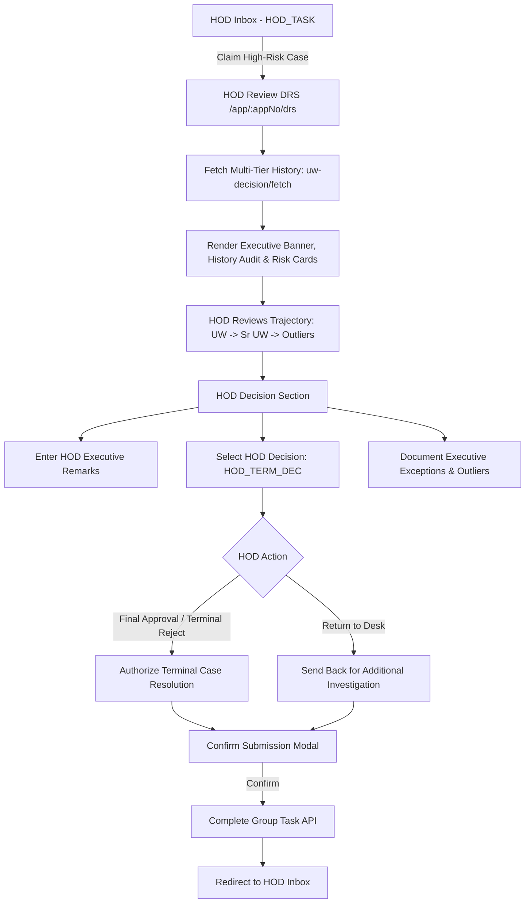

# Release Note & SIT Specification — Head of Department (HOD) Review Module

**Application:** Mid-Office — Executive Underwriting & Terminal Approval  
**Role:** Head of Department / Chief Underwriter (`HOD`, `HOD_TASK`, `ROLE_HOD`)  
**Routes:** `/app/:applicationNo/drs`, `/referral/member-selection`, `/inbox`  
**Document Version:** 1.0.0  
**Status:** Approved for SIT & Release Review  

---

## 1. Executive Summary & Purpose

The **Head of Department (HOD) Review Module** serves as the apex underwriting authority interface for high-exposure risks, treaty limit exceptions, high-net-worth (HNW) sum assured proposals, complex claim-audit referrals, and policyholder exception reviews. The HOD interface consolidates the full underwriting trajectory (Underwriter -> Senior Underwriter -> HOD), provides access to the complete decision history and risk metrics, enables recording of authoritative outlier justifications, and executes final terminal underwriting authorizations (Final Accept, Final Reject, Exceptional Terms Approval, or Return for Reconsideration).

---

## 2. Key Capabilities & Feature Breakdown

### 2.1 Executive Overview & Banner Interface (`ReferralDrsPage`)
- **Executive Referral Banner:** Highlights scheme identity, high Sum at Risk, comprehensive rider attachments, and core risk classification.
- **Risk Cards & Medical/Financial Access:** Access to full financial spreadsheets, tax audits, medical test results, and TPA reports.
- **BRE Overall Decision & Remarks Banner:** Summarizes automated rules engine conclusions alongside underwriter adjustments.

### 2.2 End-to-End Underwriting Decision History (`DECISION_HISTORY_COLUMNS`)
Provides the HOD with complete audit transparency into earlier evaluation tiers:
- Chronological trail displaying **Junior Underwriter** and **Senior Underwriter** findings.
- Comparative view of medical decisions, financial clearance decisions, and smoker risk ratings.
- Explicit display of escalation reasons (*"Referral Reason"*) and specific referral remarks entered by Senior Underwriters.

### 2.3 Strategic Data Tracking & Compliance
- **SDT Indicators (`GuwSdtRow`):** Strategic markers highlighting reinsurance mandates, AML alerts, or special executive flags.
- **Claim Audit Drill-Down:** Direct access to past claim history and investigation summaries.

### 2.4 HOD Terminal Decisioning (`ReferralDecisionSection`)
- **HOD Remarks (`HOD Remarks`):** Executive commentary documenting the final rationale and governance approval.
- **HOD Decision (`HOD Decision`):** Dropdown populated from the HOD master catalog (`HOD_TERM_DEC`), supporting:
  - *Final Accept / Standard Approval*
  - *Accept with Special Conditions / Executive Loading*
  - *Final Decline / Terminal Rejection*
  - *Postpone with Reconsideration Window*
  - *Re-route / Send Back to Underwriting Team*
- **Executive Outliers Recording:** Specialized outlier field recording executive mandate overrides, corporate treaty exceptions, or commercial concession reasons for regulatory reporting.
- **Submission Confirmation Guard:** Dual-confirmation modal ensuring high-value cases are not submitted accidentally.
- **Terminal Task Completion (`useReferralCompleteTask`):** Closes the underwriting task in the enterprise BPM system, emits audit events, and redirects to the HOD Inbox.

---

## 3. Architecture & Executive Workflow

---

## 4. API Integration & Environment Matrix

| API Operation | Endpoint | Method | Trigger Component | Status | Impact / Behavior |
|---|---|---|---|---|---|
| **Claim HOD Task** | `/api/v1/inbox/claim` | POST | `GroupInboxPage` / `RetailInbox` | Active / Working | Locks executive task to current HOD user |
| **Fetch HOD DRS** | `/api/v1/drs/fetch` | POST | `ReferralDrsPage` | Active / Working | Populates scheme details, high Sum at Risk, and risk cards |
| **Fetch Decision History** | `/api/v1/drs/uw-decision/fetch` | POST / GET | `ReferralDrsPage` (`useGetGuwUwDecisionHistoryQuery`) | Active / Working | Renders multi-tiered decision trail (UW -> Sr UW) |
| **Claim Audit Details** | `/api/v1/drs/claim-audit/list` | POST | `ReferralDrsPage` | Active / Working | Loads prior claims investigation details |
| **Complete HOD Task** | `/api/v1/task/complete` | POST | `useReferralCompleteTask` | Active / Working | Finalizes case in workflow engine; sends case for policy issuance/closure |

---

## 5. System Integration Testing (SIT) Scenarios

| Test ID | Area | Scenario & Action | Test Steps | Expected Result | Priority |
|---|---|---|---|---|---|
| **HOD-01** | Navigation | Claim and Open HOD Case | Claim case from `HOD_TASK` queue | Opens Referral DRS with "HOD Remarks" and "HOD Decision" controls | P1 |
| **HOD-02** | Decision History | Multi-Tier History Verification | Load case escalated through UW and Sr UW | History table displays full chronological progression with all user roles and notes | P1 |
| **HOD-03** | Banner | Executive Banner Verification | Verify top banner details | Correctly emphasizes high Sum at Risk, scheme type, and member details | P1 |
| **HOD-04** | Decision Card | Role Label Customization | Observe Decision Section | Renders "HOD Remarks", "HOD Decision", and "Outliers" fields | P1 |
| **HOD-05** | Decision Masters | Master Catalog Resolution | Open "HOD Decision" dropdown | Options populate strictly from `HOD_TERM_DEC` master catalog | P1 |
| **HOD-06** | Outliers | Executive Outlier Capture | Enter policy exception justification in Outliers | Outliers field persists text and binds to submission payload | P1 |
| **HOD-07** | Validation | Empty Submission Check | Click Submit with empty Decision | Submitting is prevented until decision and required remarks are provided | P1 |
| **HOD-08** | Confirmation | Executive Confirmation Modal | Fill valid details -> Click Submit | Modal prompts "Do you want to submit the case?" | P1 |
| **HOD-09** | Terminal Approval | Final Policy Approval | Select "Accept" -> Confirm | Case moves to policy issuance workflow stage; task closed | P1 |
| **HOD-10** | Terminal Rejection | Final Case Decline | Select "Decline" -> Enter rationale -> Confirm | Case status set to Declined; adverse decision notices triggered | P1 |

---

## 6. Known Issues, Limitations & Mitigations

| Issue ID | Module | Description | Root Cause / Note | Workaround / Action Plan |
|---|---|---|---|---|
| **KI-HOD-01** | Decision History | Multi-hop referrals with > 5 history entries | Large history lists in high-escalation cases | Table supports vertical scroll with sticky headers for readability |
| **KI-HOD-02** | Outlier Audit | Outlier field formatting on special characters | Complex justification notes with bullets/quotes | JSON payload sanitation handles escaped characters cleanly |

---

## 7. Sign-Off & Verification Checklist

- [ ] Successful pickup of escalated cases from `HOD_TASK` pool.
- [ ] Comprehensive verification of multi-tier decision history display.
- [ ] Correct resolution of `HOD_TERM_DEC` master dropdown values.
- [ ] Successful recording and transmission of Outlier justification notes.
- [ ] Two-step confirmation modal functioning prior to final completion.
- [ ] Terminal case completion routes cleanly to downstream policy generation.
