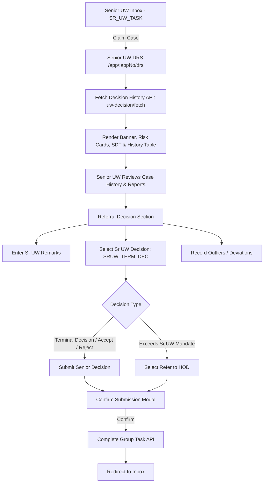

# Release Note & SIT Specification — Senior Underwriter (SR UW) Referral Module

**Application:** Mid-Office — Underwriting Referral & Escalation  
**Role:** Senior Underwriter (`SR_UW`, `SR_UW_TASK`, `SRUW`, `ROLE_SR_UW`)  
**Routes:** `/app/:applicationNo/drs`, `/referral/member-selection`, `/inbox`  
**Document Version:** 1.0.0  
**Status:** Approved for SIT & Release Review  

---

## 1. Executive Summary & Purpose

The **Senior Underwriter (SR UW) Referral DRS Module** provides a specialized review interface for complex underwriting cases escalated from primary underwriters (Retail CUW / Group GUW). Senior Underwriters possess higher financial and medical underwriting authority limits. This module equips them to inspect historical underwriting deliberations, evaluate strategic risk indicators, review full medical/financial documentation, input specialized outlier rationales, make binding senior decisions (Accept, Reject, Counter-Offer, Modify Terms), or escalate the proposal further to the Head of Department (HOD).

---

## 2. Key Capabilities & Feature Breakdown

### 2.1 Referral Header & Applicant Banner (`ReferralDrsPage`)
- **Prominent Referral Applicant Banner:** Custom styling highlighting high-value / escalated proposals, showing Applicant/Member Name, Application No., Product Name (with visual emphasis), Riders list, and cumulative Sum at Risk.
- **Risk Cards & Summary Cards:** High-level summary of proposal parameters, sourcing hierarchy, and risk profile.
- **BRE Overall Decision & Remarks Strip:** Immediate visibility of the automated rule evaluation and the initial underwriter's rationale.

### 2.2 Underwriting Decision History Table (`DECISION_HISTORY_COLUMNS`)
Comprehensive chronological multi-tier decision log loaded via `/api/v1/drs/uw-decision/fetch`:
- **User Name & Role:** Details of each underwriter who previously reviewed or modified the case.
- **UW Decision & Remarks:** Specific decision code and descriptive notes from primary underwriting.
- **Date & Timestamp:** Exact audit timestamp of the previous decision.
- **Financial & Medical Decision Breakdown:** Independent flags reflecting financial justification and medical clearance.
- **Smoker Status & Classification:** Verified underwriting tobacco classification.
- **Referral Reason & Referral Remarks:** Specific justification why the case was referred to the Senior Underwriter (e.g., Sum Assured Exceeds Mandate, Complex Medical Outlier, Financial Discrepancy).

### 2.3 Strategic Data Tracking (SDT) & Claim Audit Review
- **SDT Row (`GuwSdtRow`):** Direct inspection of strategic flags and special tracking parameters set during earlier review stages.
- **Claim Audit History (`GuwSectionDialogs`):** Modal drill-down to review prior claims investigation notes and findings.

### 2.4 Senior Decision Card (`ReferralDecisionSection`)
- **Senior UW Remarks (`Sr UW Remarks`):** Mandatory multiline underwriting rationale explaining the senior appraisal.
- **Senior UW Decision (`Sr UW Decision`):** Dropdown populated from master configuration (`SRUW_TERM_DEC`), supporting:
  - *Accept / Approve Standard*
  - *Counter Offer / Modified Terms (with loading or exclusions)*
  - *Decline / Rejection*
  - *Postpone*
  - *Refer to HOD (Further Escalation)*
  - *Send Back to UW (Requirement clarification)*
- **Outliers Tracking Field:** Explicit multiline field capturing non-standard policy exceptions, clinical waivers, or financial risk deviations for corporate audit compliance.
- **Confirm Submission Modal:** Intercepts final submission with a confirmation dialog ("Do you want to submit the case?") to prevent accidental submissions.
- **Complete Task Orchestration (`useReferralCompleteTask`):** Completes the task in the BPM engine, dispatches audit logs, clears ephemeral session state, and redirects the Senior Underwriter back to the Inbox.

---

## 3. Architecture & Escalation Workflow

---

## 4. API Integration & Environment Matrix

| API Operation | Endpoint | Method | Trigger Component | Status | Impact / Behavior |
|---|---|---|---|---|---|
| **Claim Referral Task** | `/api/v1/inbox/claim` | POST | `GroupInboxPage` / `RetailInbox` | Active / Working | Locks referral case to current Senior Underwriter |
| **Fetch Referral DRS** | `/api/v1/drs/fetch` | POST | `ReferralDrsPage` | Active / Working | Loads scheme, applicant details, risk cards, and SDT flags |
| **Fetch UW Decision History**| `/api/v1/drs/uw-decision/fetch` | POST / GET | `ReferralDrsPage` (`useGetGuwUwDecisionHistoryQuery`) | Active / Working | Populates the Underwriting Decision History audit table |
| **Claim Audit List** | `/api/v1/drs/claim-audit/list` | POST | `ReferralDrsPage` | Active / Working | Displays past claims investigation details |
| **Complete Senior Task** | `/api/v1/task/complete` | POST | `useReferralCompleteTask` | Active / Working | Submits senior decision, remarks & outliers; completes BPM task |

---

## 5. System Integration Testing (SIT) Scenarios

| Test ID | Area | Scenario & Action | Test Steps | Expected Result | Priority |
|---|---|---|---|---|---|
| **SRUW-01** | Navigation | Claim and Open Senior Referral | From Inbox, claim case with role `SR_UW_TASK` | Case opens in Referral DRS with Senior UW decision controls | P1 |
| **SRUW-02** | Decision History | History Table Rendering | Load case with prior Underwriter referral | History table lists all previous underwriter actions, dates, decisions, and referral remarks | P1 |
| **SRUW-03** | Banner | Senior Referral Banner Style | Observe top applicant banner | Shows correct styling, Product, Riders, and Sum at Risk | P1 |
| **SRUW-04** | Decision Card | Role Labels Verification | Observe Decision Section | Labels render as "Sr UW Remarks" and "Sr UW Decision" | P1 |
| **SRUW-05** | Decision Masters | Master Options Population | Open "Sr UW Decision" dropdown | Options match `SRUW_TERM_DEC` (Accept, Reject, Refer to HOD, etc.) | P1 |
| **SRUW-06** | Outliers | Outlier Data Capture | Enter text in "Outliers" field | Outliers string persists and is bound to submit payload | P2 |
| **SRUW-07** | Validation | Empty Submission Guard | Click Submit with empty Decision or Remarks | Validation prompts user to fill mandatory decision/remarks | P1 |
| **SRUW-08** | Confirmation | Confirm Dialog Trigger | Fill valid details -> Click Submit | "Confirm Submission" dialog opens ("Do you want to submit the case?") | P1 |
| **SRUW-09** | Escalation | Escalation to HOD | Select "Refer to HOD" -> Confirm | Case routes to HOD task queue upon task completion | P1 |
| **SRUW-10** | Completion | Final Senior Approval | Select "Accept" -> Enter remarks -> Confirm | Case completes senior underwriting stage and routes to policy issuance | P1 |

---

## 6. Known Issues, Limitations & Mitigations

| Issue ID | Module | Description | Root Cause / Note | Workaround / Action Plan |
|---|---|---|---|---|
| **KI-SRUW-01** | Decision History | Empty state when previous decision history is null | Backend occasionally returns empty array for direct intake referrals | UI gracefully renders empty table state with fallback message |
| **KI-SRUW-02** | Complete Task | 503 response if BPM workflow engine is down | Infrastructure dependency on task router | User stays on DRS page without losing typed remarks/outliers; retry available |

---

## 7. Sign-Off & Verification Checklist

- [ ] Successful pickup of escalated cases from `SR_UW_TASK` pool.
- [ ] Correct chronological display of Underwriting Decision History.
- [ ] Proper loading and population of `SRUW_TERM_DEC` master options.
- [ ] Outlier documentation correctly captured for audit tracking.
- [ ] Confirm submission modal functions as expected before task completion.
- [ ] Verified routing to HOD pool when "Refer to HOD" is executed.
